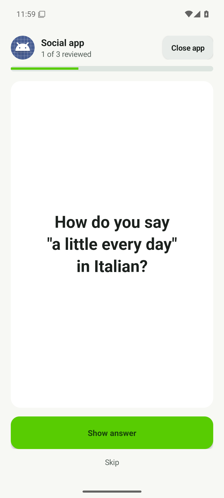
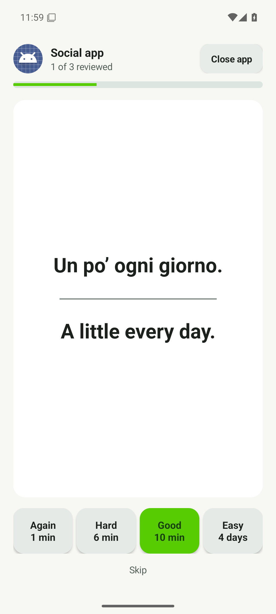
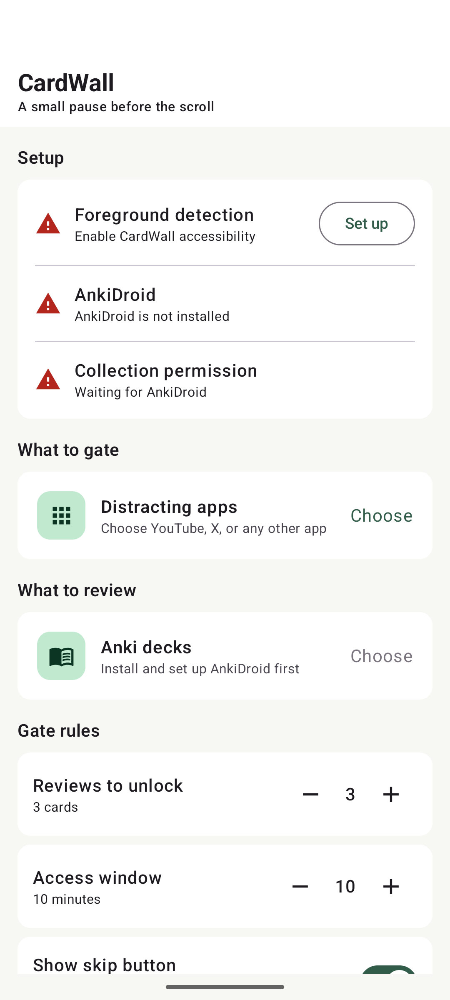

<div align="center">

# CardWall

### A small pause before the scroll.

Turn the apps you open on autopilot into a few moments of learning.

[](https://github.com/cosmith/CardWall/actions/workflows/android.yml)
[](https://github.com/cosmith/CardWall/actions/workflows/release.yml)

[**Download an APK**](https://github.com/cosmith/CardWall/releases) · [Setup guide](INSTALL.md) · [Report a bug](https://github.com/cosmith/CardWall/issues)

</div>

You open a distracting app. CardWall asks you to review a few cards from your
AnkiDroid decks first. Finish your reviews, and the app opens for a short window.

**Three cards. Ten minutes. Your decks. Your choice of apps.**

> [!WARNING]
> **CardWall is purely vibe-coded.** This is an experimental personal project built
> with AI-generated code. Expect bugs; it has not been independently security-audited.
> It writes real review grades to AnkiDroid, so **back up your Anki collection before
> using it**. Use at your own risk.

## See it in action

| Review a card | Reveal and grade | Make it yours |
| :---: | :---: | :---: |
|  |  |  |

*Actual app UI captured in an Android emulator. Review screens use a sample
Italian card; settings show initial setup.*

## How it works

1. **Choose the apps that pull you in.** Gate social feeds, video apps, or other
   distractions you want a little more space from.
2. **Choose what you want to remember.** Pick your AnkiDroid decks. Selecting a
   parent deck includes all its subdecks, including ones you add later.
3. **Review before you scroll.** Reveal the answer and grade it with Anki's familiar
   Again, Hard, Good, and Easy buttons. Every submitted grade counts.
4. **Get a little time back in the app.** Complete the target and the gate disappears.
   When the access window expires, it's time for another short review.

There is no separate collection to maintain and no new learning account to create.
CardWall works with the cards you already use in AnkiDroid.

## Make the pause your own

| Setting | Default | What you control |
| --- | --- | --- |
| Reviews to unlock | 3 cards | 1–20 reviews per session |
| Access window | 10 minutes | 1–120 minutes of access per app |
| Apps | Your selection | Which installed apps are gated |
| Decks | Your selection | Which deck branches to review |
| Skip button | Off | Optional skip with an explicit confirmation |

Each app has its own access window. Time keeps passing when you switch apps or
lock the screen. Leaving an unfinished review session discards its progress.

With **Show skip button** enabled, **Skip** asks for confirmation before opening
the current app for the normal access window. Skipped cards are not graded.
Canceling brings you back to the same card.

## Get started

CardWall is a sideloaded Android app. The intended device is a **Pixel running
Android 17**; other devices and Android versions are not validated.

1. Install and set up [AnkiDroid](https://ankidroid.org/), then sync or import your decks.
2. Download the APK from [GitHub Releases](https://github.com/cosmith/CardWall/releases)
   and install it. Android may ask you to allow installation from your browser or Files app.
3. Open CardWall, grant access to your AnkiDroid collection, and choose your decks and apps.
4. Enable CardWall in **Android Settings → Accessibility**.
5. Open one of your selected apps and try your first review.

See the [step-by-step installation and smoke-test guide](INSTALL.md) if you get stuck.
New signed releases can update an existing installation without uninstalling it.

## Local by design

- **No account, ads, analytics, or cloud backend.**
- **No internet permission.** Remote requests from flashcards are blocked.
- **Your decks stay in AnkiDroid.** CardWall reads cards through its collection API
  and writes back the grades you actually submit.
- **Foreground detection, not screen reading.** The accessibility service observes
  which app is foreground; it does not request access to other apps' view contents.

## What to know before relying on it

- **It is a nudge you control.** You can turn off the accessibility service or
  uninstall CardWall in Android settings at any time.
- **Nothing due?** CardWall falls back to random eligible cards. Those have a
  single **Reviewed** button and do not change the card's schedule.
- **AnkiDroid unavailable?** CardWall allows access and shows a warning rather than
  trapping you behind a broken review screen. This also happens if a grade cannot be saved.
- **Text first.** HTML, CSS, and card JavaScript are preserved, but images, video,
  and audio are currently replaced with placeholders.
- **Temporary sessions.** Unfinished progress is discarded when you leave or lock
  the screen. Access windows are cleared when the service or phone restarts.
- **Early software.** Automated checks and emulator screenshots do not replace
  testing the Anki integration and accessibility behavior on your own device.

## Build or contribute

The app is written in Kotlin: Compose for settings, a native accessibility overlay
for the gate, and a WebView for flashcards. Preferences stay on-device;
review progress and access windows stay in memory.

With **JDK 17**, **Android SDK 36**, and **Build Tools 37.0.0** installed:

```bash
./gradlew testDebugUnitTest lintDebug assembleDebug
```

The debug APK is in `app/build/outputs/apk/debug/`. For a local signed release,
copy `signing.properties.example` to `signing.properties`, fill in your private
keystore details, and run `./gradlew assembleRelease`. Never commit the keystore
or its passwords. Use the original release key to update an existing installation.

Every push to `main` runs the [release workflow](.github/workflows/release.yml),
which tests, builds, signs, and publishes an APK with a checksum and a commit-specific
tag. **The repository's signing secrets must be configured before downloads can
be published.** See [release setup and screenshot capture](docs/RELEASING.md).

Found a rough edge? [Open an issue](https://github.com/cosmith/CardWall/issues)
with your Android version, AnkiDroid version, what you expected, and what happened.
Avoid including private card content in screenshots or logs.
